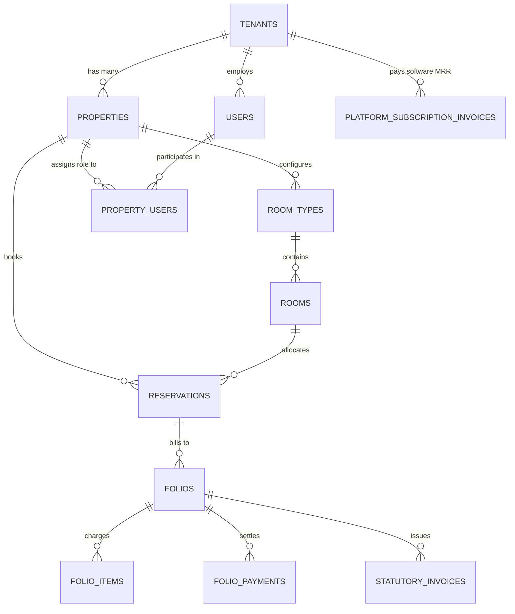

# System Architecture & Technical Specifications

This document defines the architectural decisions, database models, security boundaries, and concurrency controls of the Enterprise Hospitality ERP and SaaS Cloud.

---

## 1. Architectural Topology & Design Decisions

| Architectural Area | Decision / Technology | Rationale |
| :--- | :--- | :--- |
| **System Topology** | Modular Monolith (NestJS + Next.js 15) | Single unified codebase with strong domain module boundaries; low operational complexity, single deployable container, zero inter-service network latency. |
| **Multi-Tenancy** | PostgreSQL 16 forced Row-Level Security (RLS) | Every table (except root `tenants`) enforces `tenant_id = nullif(current_setting('app.tenant_id', true), '')::uuid`. Accidental omissions of `WHERE tenant_id` in application code cannot leak cross-tenant records. |
| **Multi-Property Scoping** | Property-level context switching | Organizations (`tenants`) govern multiple physical hotel branches (`properties`). Session tokens carry both `tid` and `pid`. Property-scoped tables enforce `property_id = nullif(current_setting('app.property_id', true), '')::uuid`. |
| **SaaS Cloud Platform HQ** | Dedicated Operations Tenant (`platform-hq`) | Separates software recurring revenue (MRR, ARR, churn) from individual hotel operations. Platform admin endpoints enforce founder authorization checks. |
| **Double-Booking Guard** | PostgreSQL `EXCLUDE USING gist` on `(room_id, date_range)` | Concurrent booking attempts conflicting on the same physical room and dates are rejected at the database engine level; eliminates race conditions without distributed application locks. |
| **Indian GST Engine** | Server-authoritative dual-slab calculation | SAC 996311 with 12% (tariff &le; ₹7,500) and 18% (tariff &gt; ₹7,500). Programmatic enforcement of Income Tax Section 269ST (₹2L cash cap) and Rule 114B PAN validation. |
| **Session Security** | HTTP-only JWT cookies (`erp_token`) | JWTs never reach browser client-side JavaScript (mitigating XSS extraction). Stored in secure, same-site cookies managed by Next.js Server Actions. |
| **Sensitive Data Security** | AES-256-GCM encryption | Foreign passport documents, Aadhaar details, and government IDs are encrypted at rest with server-side keys. Indian Aadhaar numbers are masked to last 4 digits per UIDAI compliance. |
| **Monetary Precision** | `numeric(12,2)` | Eliminates floating-point rounding errors across folios, invoices, taxes, and platform MRR ledger. |

---

## 2. Multi-Tenant Entity Relationship Model



---

## 3. Row-Level Security (RLS) Implementation

The application connects to PostgreSQL via two database roles:
1. **`erp_owner`** (Migration & Schema Maintenance): Bypasses RLS to execute migrations and backfills.
2. **`erp_app`** (Runtime Application Role): Restricted non-owner role subject to forced Row-Level Security.

### Transaction Scope Injection (`DbService`)
Every transactional query is wrapped in:
```sql
BEGIN;
SELECT set_config('app.tenant_id', $1, true);
SELECT set_config('app.property_id', $2, true);
-- App queries execute here under strict RLS isolation
COMMIT;
```
Because `set_config(..., true)` is transaction-local, pooled connection reuse never leaks tenant or property context to subsequent HTTP requests.

---

## 4. Double-Booking Prevention

Physical room allocations use PostgreSQL GiST range indexes:
```sql
ALTER TABLE reservations
  ADD CONSTRAINT reservations_room_no_overlap
  EXCLUDE USING gist (
    property_id WITH =,
    room_id WITH =,
    tstzrange(check_in, check_out, '[)') WITH &&
  )
  WHERE (status NOT IN ('cancelled', 'no_show'));
```
Any concurrent transaction attempting to allocate an already-booked room triggers a PostgreSQL exclusion constraint violation (`23P01`), which the API catches and translates into a friendly `409 Conflict` error.

---

## 5. Software Subscription & Platform HQ Architecture

The SaaS revenue architecture tracks recurring income through:
- `tenants`: Stores organization status (`active`, `suspended`), contact metadata, churn reason, and churn date.
- `property_subscriptions`: Governs feature gates and room/user quotas per plan tier (`starter`, `growth`, `enterprise`).
- `platform_subscription_invoices`: Cumulative software revenue ledger tracking paid monthly fees, billing start/end dates, and payment methods.

### Access Boundary
- **SaaS Founder Access**: Strictly gated by `ensurePlatformAuthorized()`. Only users with `slug === 'platform-hq'` or founder email credentials can query `/platform/overview` or perform platform updates.
- **Client Isolation**: Client hotel owners (such as Taj, ITC, or independent boutiques) have zero access to platform revenue endpoints and are isolated within their own property scope.
