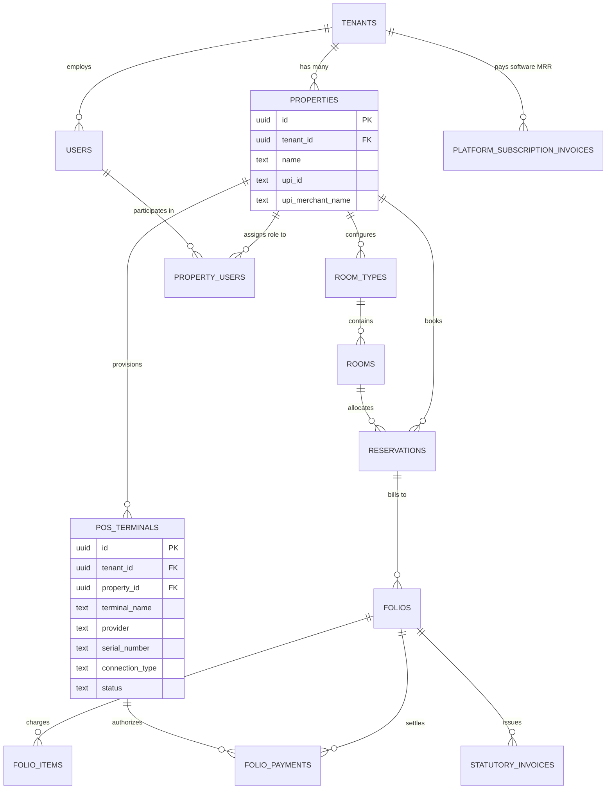

# System Architecture & Technical Specifications

This document defines the architectural decisions, database models, security boundaries, and concurrency controls of the Enterprise Hospitality ERP and SaaS Cloud.

---

## 1. Architectural Topology & Design Decisions

| Architectural Area | Decision / Technology | Rationale |
| :--- | :--- | :--- |
| **System Topology** | Modular Monolith (NestJS + Next.js 15) | Single unified codebase with strong domain module boundaries; low operational complexity, single deployable container, zero inter-service network latency. |
| **Multi-Tenancy** | PostgreSQL 16 forced Row-Level Security (RLS) | Every table (except root `tenants`) enforces `tenant_id = nullif(current_setting('app.tenant_id', true), '')::uuid`. Accidental omissions of `WHERE tenant_id` in application code cannot leak cross-tenant records. |
| **Multi-Property Scoping** | Property-level context switching | Organizations (`tenants`) govern multiple physical hotel branches (`properties`). Session tokens carry both `tid` and `pid`. Property-scoped tables enforce `property_id = nullif(current_setting('app.property_id', true), '')::uuid`. |
| **SaaS Cloud Platform HQ** | Dedicated Operations Tenant (`platform-hq`) | Separates software recurring revenue (MRR, ARR, churn) from individual hotel operations. Platform admin endpoints enforce founder authorization checks. |
| **Double-Booking Guard** | PostgreSQL `EXCLUDE USING gist` on `(room_id, date_range)` | Concurrent booking attempts conflicting on the same physical room and dates are rejected at the database engine level; eliminates race conditions without distributed application locks. |
| **Indian GST Engine** | Server-authoritative dual-slab calculation | SAC 996311 with 12% (tariff &le; ₹7,500) and 18% (tariff &gt; ₹7,500). Programmatic enforcement of Income Tax Section 269ST (₹2L cash cap) and Rule 114B PAN validation. |
| **Session Security** | HTTP-only JWT cookies (`erp_token`) | JWTs never reach browser client-side JavaScript (mitigating XSS extraction). Stored in secure, same-site cookies managed by Next.js Server Actions. |
| **Sensitive Data Security** | AES-256-GCM encryption | Foreign passport documents, Aadhaar details, and government IDs are encrypted at rest with server-side keys. Indian Aadhaar numbers are masked to last 4 digits per UIDAI compliance. |
| **Monetary Precision** | `numeric(12,2)` | Eliminates floating-point rounding errors across folios, invoices, taxes, and platform MRR ledger. |
| **Banking Settlement Security** | Owner-Exclusive `PROPERTY_BANKING_MANAGE` RBAC | Direct hotel receiving UPI ID (`upi_id`) and merchant name are restricted to `user.role === 'owner'`. General Managers, Front Desk Receptionists, and Floor Staff receive 403 Forbidden on writes, preventing unauthorized bank redirect. |
| **Direct Guest Booking** | Public Zero-Commission Booking Engine (`/book/[slug]`) | Public unauthenticated API endpoints decorated with `@Public()` with input validation and rate limiting. Allocates live rooms directly to the tape chart and bypasses 18-25% OTA commissions. |
| **Hardware POS Integration** | Multi-Protocol EDC Terminal Adapter (LAN / Cloud Push / Web Serial) | Pluggable POS hardware layer supporting Pine Labs Plutus, Paytm Smart POS, Innoviti uniPAY, Razorpay EzeTap, Ingenico Lane IP, and W3C Web Serial USB connection for 0-latency cashiering card charges and authentic thermal slips. |

---

## 2. Multi-Tenant Entity Relationship Model



---

## 3. Row-Level Security (RLS) Implementation

The application connects to PostgreSQL via two database roles:
1. **`erp_owner`** (Migration & Schema Maintenance): Bypasses RLS to execute migrations and backfills.
2. **`erp_app`** (Runtime Application Role): Restricted non-owner role subject to forced Row-Level Security.

### Transaction Scope Injection (`DbService`)
Every transactional query is wrapped in:
```sql
BEGIN;
SELECT set_config('app.tenant_id', $1, true);
SELECT set_config('app.property_id', $2, true);
-- App queries execute here under strict RLS isolation
COMMIT;
```
Because `set_config(..., true)` is transaction-local, pooled connection reuse never leaks tenant or property context to subsequent HTTP requests.

---

## 4. Double-Booking Prevention

Physical room allocations use PostgreSQL GiST range indexes:
```sql
ALTER TABLE reservations
  ADD CONSTRAINT reservations_room_no_overlap
  EXCLUDE USING gist (
    property_id WITH =,
    room_id WITH =,
    tstzrange(check_in, check_out, '[)') WITH &&
  )
  WHERE (status NOT IN ('cancelled', 'no_show'));
```
Any concurrent transaction attempting to allocate an already-booked room triggers a PostgreSQL exclusion constraint violation (`23P01`), which the API catches and translates into a friendly `409 Conflict` error.

---

## 5. Software Subscription & Platform HQ Architecture

The SaaS revenue architecture tracks recurring income through:
- `tenants`: Stores organization status (`active`, `suspended`), contact metadata, churn reason, and churn date.
- `property_subscriptions`: Governs feature gates and room/user quotas per plan tier (`starter`, `growth`, `enterprise`).
- `platform_subscription_invoices`: Cumulative software revenue ledger tracking paid monthly fees, billing start/end dates, and payment methods.

### Access Boundary
- **SaaS Founder Access**: Strictly gated by `ensurePlatformAuthorized()`. Only users with `slug === 'platform-hq'` or founder email credentials can query `/platform/overview` or perform platform updates.
- **Client Isolation**: Client hotel owners (such as Taj, ITC, or independent boutiques) have zero access to platform revenue endpoints and are isolated within their own property scope.

---

## 6. Banking Settlement Security & Public Direct Booking Engine Architecture

### A. Owner-Exclusive Banking Settlement Authority
- **Migration 019 (`019_property_upi_receiver.sql`)**: Added `upi_id` (VPA) and `upi_merchant_name` to the `properties` table.
- **Access Control Rule**: Added `PROPERTY_BANKING_MANAGE` feature permission. The API controller (`BillingController.updateUpiSettings`) explicitly checks:
  ```typescript
  if (user.role !== 'owner') {
    throw new ForbiddenException('Only property owners are authorized to modify bank receiving UPI settings.');
  }
  ```
- **Security Justification**: Front desk agents and general managers handle daily operational check-in/out and cashiering settlements, but must never have the authority to alter the bank account where customer funds settle. Gating VPA modification behind the Owner role eliminates internal theft and unauthorized fund diversion.

### B. Dynamic NPCI Scan-to-Pay QR Generator
- **Payload Generation**: Follows NPCI specifications:
  `upi://pay?pa={upi_id}&pn={encodeURIComponent(upi_merchant_name)}&am={amount}&cu=INR&tr={folio_number}`
- **Security Countdown**: Client component (`UpiQrCard`) incorporates a 10-minute session expiry countdown timer, preventing stale payments or race conditions during cashier shift handover.
- **Reconciliation**: Front desk cashier validates the payment on their banking terminal/app and records the 12-digit Indian bank UTR (Unique Transaction Reference) number into the folio audit trail.

### C. Public Direct Guest Booking Engine
- **Controller**: `PublicBookingController` provides public `@Public()` endpoints:
  - `GET /public/hotels/:slug`: Fetches hotel profile, available room categories, base tariffs, and verified receiving UPI ID.
  - `POST /public/direct-booking`: Validates guest details, stay dates, and room selection via `directGuestBookingSchema`.
- **Automatic Allocation**: Executes an atomic transaction that creates or retrieves the guest profile, allocates the room via the GiST double-booking guard, generates an initial reservation record (`status = confirmed`, `source = direct`), and provisions an active folio with room charges and taxes.
- **0% Commission Advantage**: Allows hoteliers to capture direct bookings without surrendering 18–25% in OTA commissions to MakeMyTrip, Agoda, or Booking.com.

---

## 7. Physical POS Machine (EDC Terminal) Architecture

- **Data Models**:
  - `pos_terminals`: Gated by tenant and property RLS. Stores hardware provider (`pine_labs`, `paytm`, `innoviti`, `razorpay`, `ingenico`, `generic_serial`), terminal IP, port, serial number, assigned counter/desk, status (`online`, `offline`), and connection mode (`lan_ip`, `cloud_push`, `usb_serial`).
  - `folio_payments`: Extended with `pos_terminal_id`, `card_brand`, `card_last_four`, `bank_rrn`, `auth_code`, and `pos_slip_data` (structured JSON).
- **Communication Pipelines**:
  - **LAN IP Sockets**: Asynchronous JSON-RPC / REST dispatch to terminal IP addresses on the local hotel subnet.
  - **Cloud Push Queues**: Integrations with Pine Labs Plutus Cloud and Paytm Smart POS webhooks.
  - **W3C Web Serial API**: Direct browser-to-USB serial pairing (`navigator.serial`) at 9600/115200 baud for cashiering PCs connected directly to pinpads without desktop drivers.
- **PCI-DSS Compliance**: Strict zero-storage of full 16-digit PANs or 3-digit CVVs. Stores only masked card numbers (`XXXX-XXXX-XXXX-1289`) alongside bank-authoritative RRN and Auth Codes for dispute resolution.

---

## 8. Integrated Aura Dine F&B Restaurant POS & KOT Architecture

### A. Data Schema & Isolation (Migrations 021 & 022)
- `restaurant_outlets`: Multiple dining venues per hotel (Fine Dining, Roof-Top Lounge, In-Room Dining, Poolside Bar, Standalone Bistros). Stores FSSAI license, GSTIN, service charge %, contact phone, and standalone flags.
- `restaurant_tables`: Physical table master with table numbers, capacity (covers), floor zones/sections (*Main AC Hall*, *Open Terrace Garden*, *Poolside Deck*, *Bar & Lounge*), and occupancy statuses (`vacant`, `occupied`, `billed`). Supports `is_merged` and `merged_with_table_id`.
- `menu_categories` & `menu_items`: Hierarchical digital menu with dietary badges (`is_veg`, `is_vegan`, `contains_egg`), preparation time, spice levels, and prices.
- `kot_orders` & `kot_order_items`: Kitchen Order Tickets tracking chronological order states (`pending` ➔ `preparing` ➔ `ready` ➔ `served` ➔ `settled` ➔ `cancelled`). Supports subsequent KOT rounds (`round_number`), discounts, service charge, and split flags.
- `kot_order_splits`: Split billing ledger enabling equal 2-5 way splits or itemized custom splits with independent tenders (Cash, UPI QR, EDC POS Card, Room Charge).
- `restaurant_customers`: Standalone restaurant CRM tracking diner phone, name, email, dietary preferences (Veg, Non-Veg, Jain), visit count, and total spend.

### B. Table & Menu Management APIs
- **Table Operations (`POST /hotel/restaurant/tables`, `PATCH /hotel/restaurant/tables/:id`, `DELETE /hotel/restaurant/tables/:id`)**:
  - Full CRUD management of tables per outlet.
  - Interactive "+ Add Table" modal with covers, floor zones (*Main AC Hall*, *Open Terrace*, *Poolside Deck*, *Bar & Lounge*), and outlet selector.
  - Safe deletion guard preventing deletion of tables with active dining sessions or pending KOTs.
- **Menu Management (`POST /hotel/restaurant/menu/categories`, `POST /hotel/restaurant/menu/items`)**:
  - Digital menu authoring with category sorting, dietary classification (Veg, Non-Veg, Egg), SAC 996331, and 5% GST.
- **Table Shifting (`transferTable`)**: Atomically shifts active order from Table A to Table B and vacates Table A.
- **Table Merging (`mergeTables`)**: Combines line items from two adjacent tables into a single consolidated master order, linking both tables.

### C. Tax Isolation & Folio Posting Engine
- **SAC 996331**: Food & Beverage charges are tagged strictly with SAC `996331` at 5% GST (2.5% CGST + 2.5% SGST without ITC).
- **Atomic Folio Charge Posting**:
  ```typescript
  // RestaurantController.chargeToRoom
  // 1. Validates active checked-in reservation folio
  // 2. Inserts folio_item with SAC 996331 and 5% GST
  // 3. Atomically updates folio total and balance
  // 4. Transitions KOT order status to 'settled' and associated tables to 'vacant'
  ```
- **80mm ESC/POS Slip Generation**:
  - `KotPrintModal`: Industry-standard kitchen order tickets with running KOT number, table/room ID, ordered quantities, prep notes, and server timestamp.
  - `BillPrintModal`: Official 80mm customer tax receipt with FSSAI license, GSTIN, SAC 996331 tax breakdown, discounts, service charge, and payment mode.

---

## 9. Enterprise Key Management & Hardware Bridge (Brass Rack & RFID)

### A. Dual Key Philosophy
- **Physical Brass Keys**: Accommodates heritage palaces, luxury havelis, and boutique properties using engraved brass room keys. Visual wooden rack reflects key location (`in_slot`, `issued_to_guest`, `with_housekeeping`, `lost`).
- **Electronic RFID Keycards**: MIFARE Classic 1K / Ultralight contactless smart cards. The W3C Web Serial encoder bridge connects directly to front desk USB RFID card writers.

### B. Hardware Bridge Workflow
1. Front desk receptionist places a blank MIFARE 1K card on the USB card writer.
2. Web client opens serial port via `navigator.serial.requestPort()`.
3. Client dispatches encrypted sector write command containing property ID, room number, reservation ID, and check-out expiry timestamp.
4. Serial reader responds with card UID (e.g. `04:A2:8F:12:5B:60:80`).
5. ERP records UID in `room_keys` and marks key as `issued_to_guest`.
6. Digital QR Mobile Pass is simultaneously generated for contactless keyless entry via smartphone cameras.
