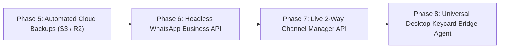

# Antigravity Hospitality ERP — Architecture Baseline & Future Roadmap

**Document Version:** 1.0.0  
**Baseline Date:** November 25, 2026  
**Codebase Scale:** 68,219 Lines of Code · 281 Source Files  
**Target Market:** Luxury Palace Chains, Mid-Scale Corporate Hotels, Independent Boutique Resorts & SaaS Hospitality Cloud (India & Global)

---

## 1. Executive Summary & Current Architecture Baseline

Over the past weeks and months, the Antigravity Hospitality ERP has evolved from a foundational multi-tenant PMS into a commercial-grade, multi-property hotel operations system designed to challenge legacy systems (Oracle Opera, IDS Next, Cloudbeds).

### Current Technical Baseline
* **Frontend**: Next.js 15 (App Router, React 19, Tailwind CSS 3.4, WCAG 2.2 AA Accessibility Compliant).
* **Backend**: NestJS 10 (TypeScript, Modular Architecture, Zod validation, Throttler rate limiting, Passport JWT).
* **Database**: PostgreSQL 16 with Row-Level Security (`tenant_id` and `property_id` enforcement on all operational queries).
* **Codebase Volume**: **68,219 LOC** (over 91% TypeScript/TSX).
* **Zero-Defect Standard**: Clean typecheck with **0 TypeScript errors** (`pnpm -r typecheck`).

---

## 2. Comprehensive Inventory of Completed Capabilities

### A. Operations & Front Desk
1. **Interactive Room Rack & Tape Chart (`/tape-chart`)**: Gantt-style multi-day calendar with interactive drag-to-select stay range booking, live OTA channel ribbons, and pastel category themes.
2. **Operations Dashboard (`/dashboard`)**: Real-time room turnover board, arrivals/departures counters, occupancy %, and floor-by-floor room status inspection.
3. **Emergency Contingency Engine (`FrontDeskContingencyModal`)**: 1-click printable and downloadable offline guest ledger, protecting operations against power/internet outages.
4. **Enterprise Key Management (`/keycards`)**: Dual-mode management supporting traditional brass wooden pigeonhole racks and W3C Web Serial RFID card encoder bridges (MIFARE 1K).

### B. Cashiering, Folios & Indian Statutory Compliance
1. **Dual-Slab Indian GST Engine**: Automated calculation of 12% (tariff &le; ₹7,500) and 18% (tariff &gt; ₹7,500) under SAC `996311`, plus 5% F&B dining tax under SAC `996331`.
2. **Income Tax Act Guardrails**:
   - **Section 269ST**: Automatic rejection of single cash payments &ge; ₹2,00,000 per guest per stay.
   - **Rule 114B**: Mandatory PAN card collection and validation for cash receipts &gt; ₹50,000.
3. **Statutory Immigration Compliance (`/compliance`)**: Bureau of Immigration (BoI) Form C export for foreign nationals and daily local police beat register ledgers.
4. **Night Audit Rollover (`/night-audit`)**: Automated midnight business date rollover, room posting, and Manager Flash Revenue Reports.

### C. Zero-Cost Guest KYC & Identity Redaction
1. **UIDAI Section 29 & DPDP Act 2023 Redaction Tool (`IdRedactionModal`)**:
   - Permanent in-canvas pixel destruction overwrites PII with solid `#000000` pitch black before network dispatch.
   - 1-click smart presets for Aadhaar (digits 1–8 + 2D QR code), Passport (MRZ + signature), Driving License (signature + chip), Voter ID (barcodes), and PAN cards.
   - Indelible compliance watermark footer: `SECURE KYC · MASKED UNDER SECTION 29 AADHAAR ACT / DPDP ACT 2023 · FOR HOTEL CHECK-IN USE ONLY`.
   - **₹0 recurring API cost** compared to third-party OCR vendors (saves ₹1.5–₹3.5 per guest check-in).
2. **Ephemeral QR Mobile Camera Bridge (`/scan-id/[sessionId]`)**:
   - Zero-footprint photo capture transfers ID scans directly from receptionist smartphones to desk PC forms via memory bridge.
   - No guest identity photos remain in staff WhatsApp chats or phone galleries.
3. **WebRTC Live Viewfinder & Laptop Webcam**: In-browser camera viewfinder with alignment framing guides and instant client-side image compression (<500 KB).

### D. Commercial Sellability Suite (Phases 1–4)
1. **Phase 1: Role-Based Access Control (RBAC) & Live Staff Persona Switcher**:
   - Top-header switcher allows instant role toggling during sales demos: 👑 Owner ➔ 👔 General Manager ➔ 🛎️ Front Desk ➔ 🧹 Housekeeping.
   - Live role preview alert banner with 1-click exit.
   - Strict route-level guards protect `/income`, `/settings`, `/staff`, and `/night-audit` against unauthorized access.
2. **Phase 2: Dynamic UPI QR Code with Fullscreen Counter Display**:
   - Standard NPCI UPI URI scheme embeds exact rupee balances down to the paisa.
   - Fullscreen customer kiosk mode for counter-mounted iPads or second displays.
   - Real-time SSE stream and polling auto-detect payments and record bank UTRs.
   - Owner-exclusive bank VPA management safeguards hotel funds.
3. **Phase 3: Thermal Receipt & KOT Printing**:
   - Dedicated 80mm & 58mm thermal print media CSS rules.
   - `FolioPrintModal` with raw ESC/POS byte streaming for checkouts.
   - `KotPrintModal` for kitchen ticket formatting.
4. **Phase 4: WhatsApp Guest Notification Templates**:
   - Official Indian hospitality message templates: Booking Confirmation Voucher, Pre-Arrival Digital Check-In (self-upload ID link), Welcome & Wi-Fi greeting, and Digital GST Tax Invoices.
   - 1-click dispatch to WhatsApp Web or native mobile app.
5. **Resilient REST Authentication Layer**:
   - Dedicated endpoint `/api/auth/login` eliminates Next.js `UnrecognizedActionError` hash mismatches.

---

## 3. Discrepancy & Gap Analysis

| Feature Area | Current Status | Gap / Opportunity | Commercial Priority |
| :--- | :--- | :--- | :---: |
| **Database Disaster Recovery** | Local Docker / Postgres | Automated periodic S3/R2 backups with 1-click restore | **High (Phase 5)** |
| **WhatsApp Automation** | 1-Click WhatsApp Web/App launcher | Headless background dispatch via Meta Cloud API / Interakt | **High (Phase 6)** |
| **2-Way OTA Channel Manager** | Simulator & Inbound Webhooks | Production 2-way live sync via Channex.io or Staah API | **High (Phase 7)** |
| **Physical Keycard Hardware** | W3C Web Serial (`navigator.serial`) | Background desktop tray agent for legacy serial locks | **Medium (Phase 8)** |
| **Self-Serve Tenant Billing** | Platform Admin Manual Provisioning | Automated Razorpay Subscriptions recurring checkout | **Medium (Phase 9)** |

---

## 4. Future Scaling Roadmap (Phases 5 – 8)

### Phase 5: Automated Cloud Database Backups & Disaster Recovery
* **Problem**: If a hotel's database is corrupted or server hardware fails, losing current guest folios or room reservations is catastrophic.
* **Implementation Plan**:
  1. Create automated cron task dumping PostgreSQL using `pg_dump` with gzip compression.
  2. Encrypt backups using AES-256 with an isolated secondary master key.
  3. Stream encrypted archives to an S3-compatible bucket (Cloudflare R2 or AWS S3) every 6 hours.
  4. Build an emergency **"1-Click Restore Point"** in `/platform-admin` and `/settings` for authorized administrators.

### Phase 6: Headless WhatsApp Business API Webhooks (Interakt / Gupshup / Wati)
* **Problem**: Currently, receptionists click a button to launch WhatsApp on their screen. While great for manual control, high-volume hotels (50+ rooms) want messages dispatched automatically in the background.
* **Implementation Plan**:
  1. Add a **WhatsApp Gateway Settings** tab in `/settings`:
     - Select provider: Meta Cloud API, Interakt, Gupshup, or Wati.
     - Enter API Key and Phone Number ID.
  2. Background event triggers:
     - On reservation confirmation ➔ auto-dispatch Booking Voucher.
     - At 9:00 AM on check-in date ➔ auto-dispatch Pre-Arrival Web Check-In link.
     - On folio checkout settlement ➔ auto-dispatch GST Tax Invoice PDF.

### Phase 7: Live 2-Way OTA Channel Manager Engine (Channex.io / Staah API)
* **Problem**: Hoteliers require automated two-way inventory and rate sync with MakeMyTrip, Agoda, Booking.com, and Airbnb to prevent manual calendar adjustments.
* **Implementation Plan**:
  1. Integrate **Channex.io** or **Staah API** (the hospitality industry standard channel bridges).
  2. Two-way synchronization:
     - **ARI Push (Outbound)**: When a front desk walk-in or phone booking is made, push decremented room availability to all connected OTAs within 2 seconds.
     - **Booking Pull (Inbound)**: Webhook listener receives incoming OTA reservations and automatically drops them into the Tape Chart with designated channel tags.

### Phase 8: Universal Hardware Keycard Desktop Bridge Agent
* **Problem**: While the W3C Web Serial API works cleanly for USB-UART encoders on Chrome, some legacy hotel door locks (Adel, Orbita, Salto) require proprietary Windows DLL drivers.
* **Implementation Plan**:
  1. Build a lightweight Electron / Go background tray agent (`antigravity-keybridge.exe`).
  2. Runs locally on the Front Desk PC and listens on `http://127.0.0.1:4005`.
  3. Communicates directly with manufacturer vendor SDKs to write and revoke keycards with zero browser prompts.

---

## 5. Commercial Pricing & Go-To-Market Playbook

### Recommended Pricing Tiers for Indian Hoteliers

| Plan Tier | Monthly Price | Target Property | Key Features Included |
| :--- | :---: | :--- | :--- |
| **Starter** | **₹1,999/mo** | Homestays, B&Bs, Boutique (1–10 Rooms) | Front Desk Rack, Tape Chart, GST Billing, Mobile QR Bridge, Zero-Cost ID Masking |
| **Growth** | **₹4,999/mo** | Business Hotels & Resorts (11–35 Rooms) | Everything in Starter + Restaurant POS (KOT), WhatsApp Guest Messaging, Night Audit, Police Reports |
| **Enterprise Chain** | **₹12,999/mo** | Multi-Property Chains & Palaces (35+ Rooms) | Everything in Growth + Multi-Branch Cluster Switcher, Owner P&L Analytics, Hardware POS Integration, RFID Locks |

### Pilot Onboarding Strategy
1. **Target**: 5–10 boutique hotels or luxury homestays in key tourist/business hubs (Jaipur, Udaipur, Goa, Mumbai, Delhi-NCR, Bangalore).
2. **Offer**: 30-Day Free Pilot with hands-on front desk training.
3. **Primary Sales Hook**:
   - *"Save ₹1.5 to ₹3.5 per check-in with our free UIDAI Section 29 ID masking tool."*
   - *"Zero WhatsApp footprint: front desk staff never store guest ID photos on personal phones."*
   - *"Direct dynamic UPI QR collection with customer display mode: eliminate wrong payment amounts forever."*
